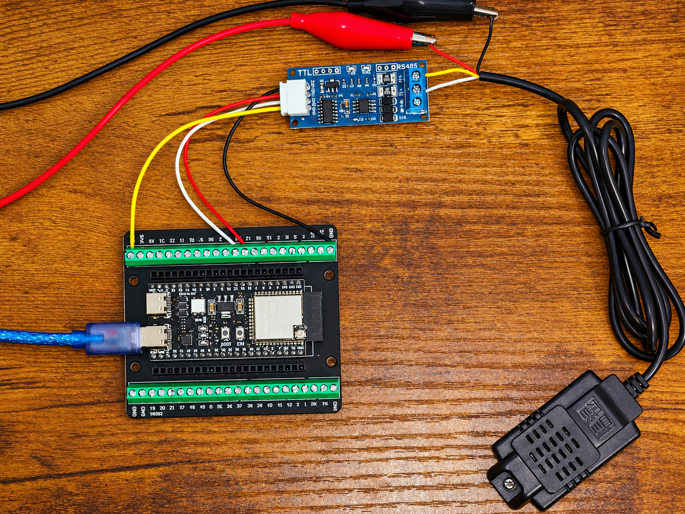
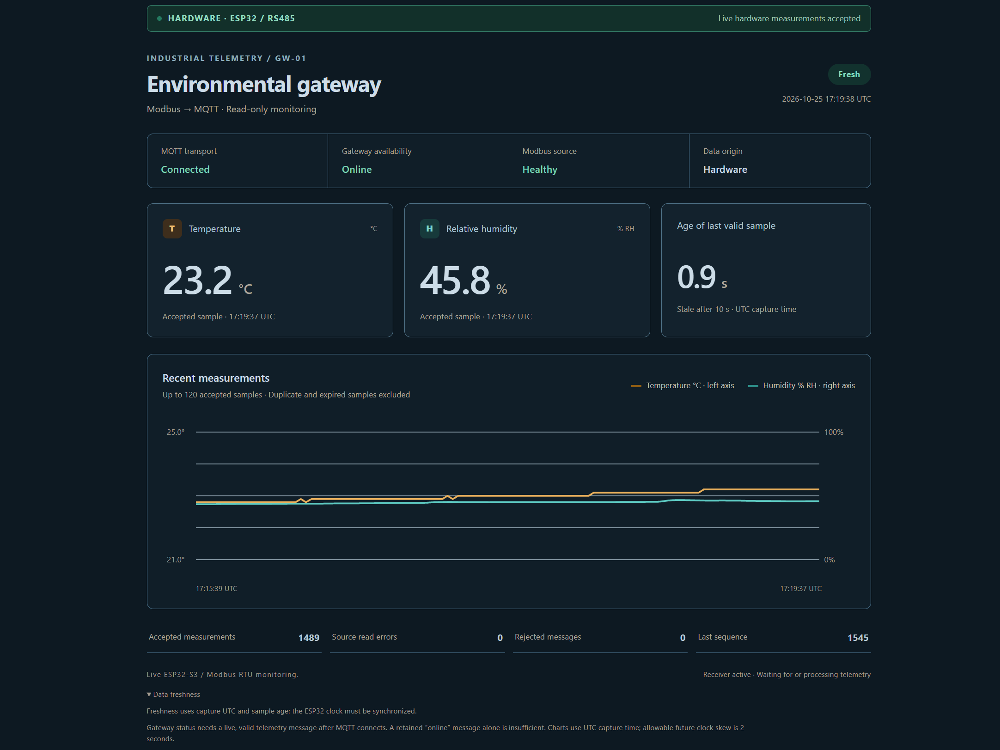
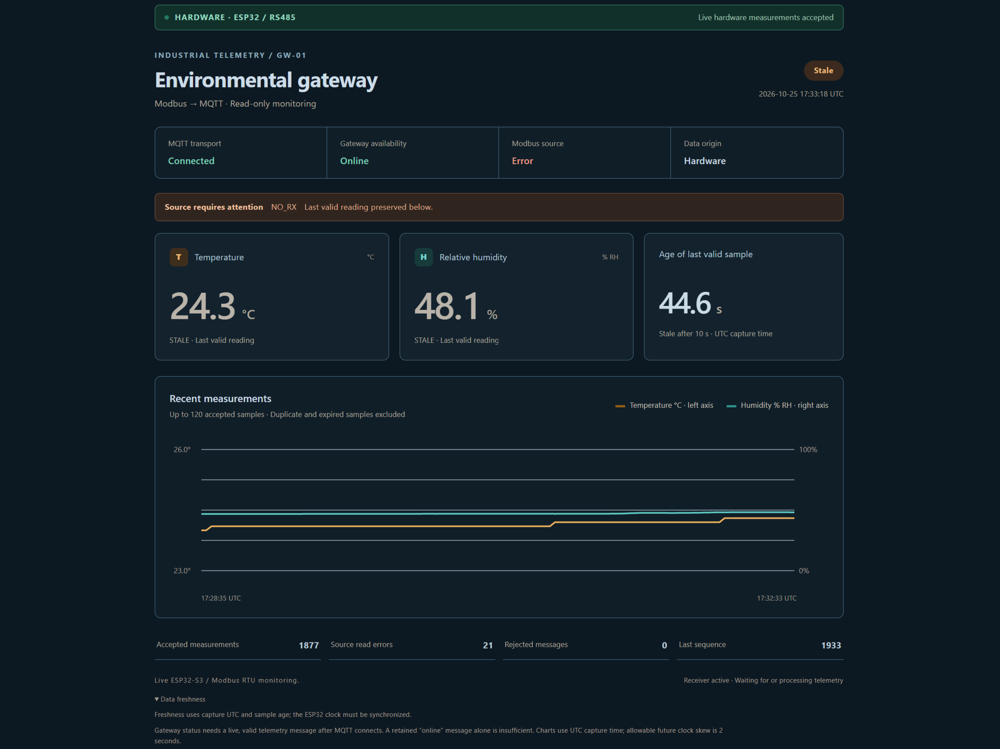
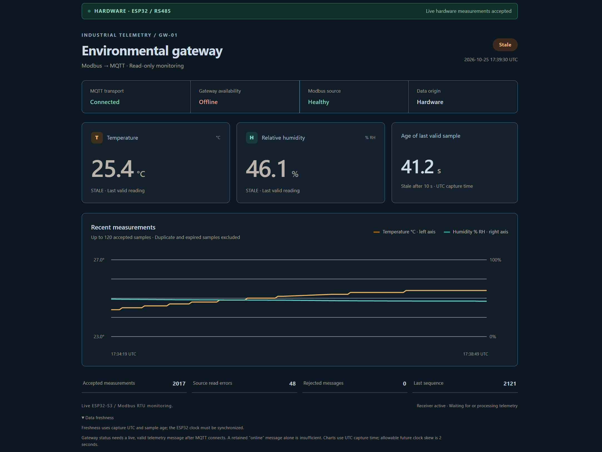

# ESP32-S3 Modbus RTU to MQTT Monitoring Gateway

I built this gateway to connect an RS485 temperature and humidity sensor to an MQTT monitoring system. An ESP32-S3 reads the SHT20 over Modbus RTU, publishes measurements over Wi-Fi, and feeds a Node-RED dashboard with live values, connection status and sensor health.

The complete physical data path is working. A recorded 60-second run produced **30 valid hardware readings with no failed or rejected telemetry**. Manual checks also confirmed that readings resume after reconnecting the sensor and after restarting the board.

## Physical prototype

The assembly uses an ESP32-S3 development board, an XY485 UART-to-RS485 interface and an SHT20 sensor. The ESP32 is powered through USB; the sensor uses a separate supply. The USB-to-RS485 adapter is a diagnostic tool and is not part of the final Wi-Fi gateway.

## Live dashboard

The dashboard separates four useful signals: MQTT connection, gateway availability, sensor communication and reading freshness. If the sensor stops responding, it preserves the last valid measurement, displays the read error and marks the measurement stale as it ages.

Communication status examples

### Sensor communication unavailable

The gateway remains online while the sensor reports `NO_RX`. The dashboard preserves the last valid values and marks them stale.

### Gateway offline

The dashboard remains connected to MQTT while the gateway is offline. Sensor status in this screenshot is the last known state; the current interface labels it explicitly as **Last known** while the gateway is unavailable.

## Architecture

## What I implemented

- **ESP-IDF firmware in C:** Modbus RTU polling, CRC validation and conversion of the sensor registers to engineering units.
- **MQTT integration:** telemetry, retained availability, Last Will configuration and diagnostic messages.
- **Connection recovery:** Wi-Fi/MQTT reconnection and continued sensor polling through communication failures.
- **Data quality handling:** explicit valid/error states, UTC timestamps, sample age, boot IDs and sequence numbers.
- **Dashboard:** live temperature and humidity, history, read-error counters and a stale-data indicator.
- **Repeatable setup:** wiring instructions, local startup scripts, a separate simulator and automated checks.

## Testing

| Check | Result |
|---|---|
| Standalone Modbus sensor | 10 valid responses from 10 requests, with valid CRCs |
| Recorded physical gateway run | 30 valid readings in 60.010 seconds; 0 failed and 0 rejected telemetry |
| Sensor disconnect and reconnect | Read errors displayed; measurements resumed after reconnection in a manual check |
| Board restart / USB reconnection | Connection and measurements resumed automatically in a manual check |
| Receiver and protocol tests | Automated checks cover parsing, errors, stale data, duplicates and message ordering |

The [test report](../HARDWARE_GATEWAY_VALIDATION_2026-10-25.md) contains the captured messages, configuration and test scope. The separate [host test fixture](../../host/README.md) uses synthetic Modbus TCP data for repeatable software checks.

## Build and run

Start with the [setup guide](SETUP.md), [firmware instructions](../../firmware/gateway/README_AR.md) and [MQTT message format](../MQTT_CONTRACT.md). The working sensor profile is unit **1**, **9600 baud / 8N1**, function **04**, start address **1**, and **2 registers**.

Set Wi-Fi and broker credentials locally. Private configuration, passwords and generated firmware binaries are excluded from this repository.

This project demonstrates a physical, read-only monitoring gateway. Sensor calibration and extended deployment testing can be added for a specific installation.
